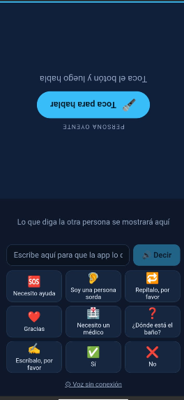
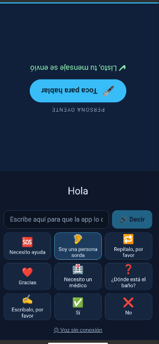

# SeñaVoz

Aplicación Android de accesibilidad que facilita la conversación cara a cara entre una persona **sorda** y una persona **oyente** usando una **pantalla dividida**:

- **Mitad superior (rotada 180°) – persona oyente:** toca el micrófono y habla. La app transcribe su voz en tiempo real.
- **Mitad inferior – persona sorda:** lee en grande lo que dijo la otra persona y responde de dos formas:
  - **Escribiendo** un mensaje que la app **lee en voz alta** (texto a voz).
  - Tocando **tarjetas de frases rápidas** ("Necesito ayuda", "Necesito un médico", "¿Dónde está el baño?"…).

## Capturas

<p align="center">
  
  
</p>

## Arquitectura

```
Frontend (Angular 21 + Capacitor 8)  ⇄  API REST (Node.js + Express)  ⇄  PostgreSQL (Neon)
 · STT: speech-recognition                · GET /api/phrases                       · quick_phrases
 · TTS: text-to-speech                    · GET /api/health
```

| Capa | Tecnología |
|---|---|
| UI | Angular 21 (standalone + signals), SCSS puro |
| Nativo | Capacitor 8, Android 7+ (minSdk 24) |
| Voz | `@capacitor-community/speech-recognition`, `@capacitor-community/text-to-speech` |
| Reactividad | RxJS (flujo continuo de voz a texto) |
| Backend | Node.js, Express, `pg` — desplegado en Vercel (`backend/api/index.js`) |
| Datos | PostgreSQL en Neon (esquema en `backend/sql/`) |

### Funciona sin conexión

`ApiService` usa la estrategia **red → caché local → frases integradas**, así la app siempre tiene tarjetas. La voz a texto y el texto a voz usan los servicios del teléfono.

## Instalar el APK

Descarga `entrega/SenaVoz.apk`, cópialo al teléfono y ábrelo (habilita “instalar apps desconocidas”). Al primer uso, concede el permiso de micrófono. Requiere el servicio de voz de Google (reconocimiento en español).

## Desarrollo

### Backend

```bash
cd backend
cp .env.example .env      # completa los datos de PostgreSQL (o DATABASE_URL de Neon)
npm install
npm run db:init           # crea las tablas e inserta las frases de ejemplo
npm run dev               # http://localhost:3000
```

Despliegue en Vercel: importar la carpeta `backend`, definir `DATABASE_URL` y `CORS_ORIGIN`.

### Frontend

```bash
cd frontend
npm install
npm start                 # http://localhost:4200 (el micrófono funciona en Chrome)
```

Para conectar la app a tu API, edita `API_URL` en `frontend/src/app/config.ts` (vacío = modo sin conexión).

### Generar el APK

Requiere JDK 17+ y Android SDK.

```bash
cd frontend
npm run build
npx cap sync android
cd android
./gradlew assembleDebug   # APK en app/build/outputs/apk/debug/
```

## Hoja de ruta

- Frases personalizables por el usuario.
- Selector de idioma.
- Historial de la conversación.
